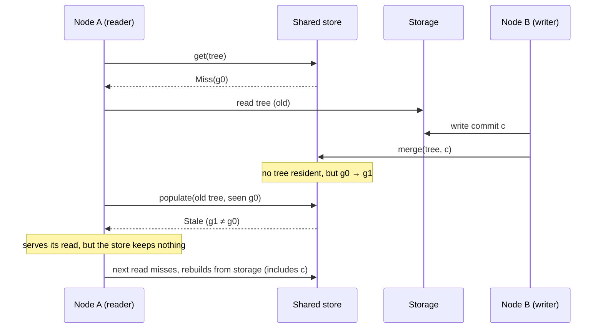
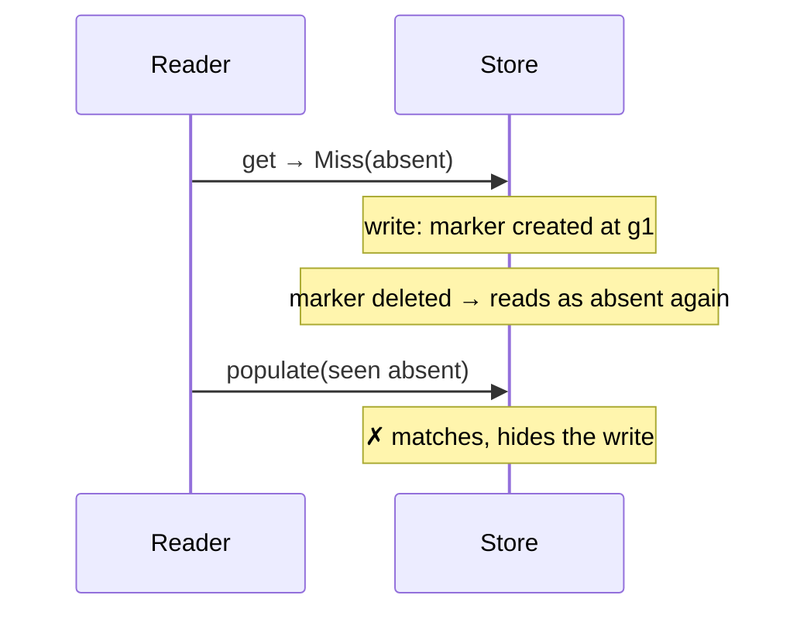

# Minimized Tree Store

How a node keeps the minimized form of each sedimentree, and how to share that store safely between nodes.

## Why a store

Serving sync needs each tree's _minimized_ form. Building it takes a full storage read plus a minimization pass, so a node keeps built trees in a `MinimizedTreeStore` and serves hot reads from there.

The store holds derived data only. Storage stays the source of truth: any entry may be dropped at any time, and the next read rebuilds it.

## Who needs a shared store

A per-node store over storage that _other_ nodes write to never sees their writes. After node B writes, node A keeps serving the tree it last read. So nodes that share storage must also share a store. They must also share the `DepthMetric`, because the store is keyed by tree id alone.

Typical deployments:

| Deployment                                   | Store                                               |
|----------------------------------------------|-----------------------------------------------------|
| One node, its own storage                    | `MemoryMinimizedTreeStore` (the default)            |
| Several nodes in one process, shared storage | `SharedMemoryMinimizedTreeStore`                    |
| Many processes or isolates, shared storage   | A networked store, such as Durable Objects or Redis |

## The race a shared store must prevent

Between a reader's storage read and its `populate`, another node can write. Populating the store with the reader's copy would then hide that write from every node.

A rejected populate is not retried. The rejected read is no staler than a hit could have been a moment earlier, and sync tolerates stale views, so the reader serves it and only declines to store it. Retrying would rescan storage without bound while other nodes keep writing.

Each tree has a _generation_ that changes whenever its stored state does. A miss returns the current generation, and `populate` succeeds only if the generation still matches.

## Rules for a shared store

1. **`populate` is a compare-and-set.** Checking `seen` against the current generation and writing the tree must be one atomic step.
2. **`merge` and `remove` change the generation even on a miss.** Without a resident tree, leave a _marker_: a generation with no tree. That's what the in-flight populate collides with.
3. **A generation never repeats for a tree.** See [Reclaiming markers](#reclaiming-markers).
4. **All four operations are serialized per tree.** A read-modify-write `merge` racing a `remove` can otherwise bring back a tree that storage no longer matches.
5. **Store calls time out.** The node holds a per-tree lock across store maintenance, so a hung call stalls that tree's writes. `ResilientMinimizedTreeStore` adds this to any store: it bounds each call with the node's `Timeout` effect and opens a circuit breaker after a run of consecutive failures, so an outage costs no remote calls and degrades to reading storage directly.
6. **Fail closed.** If maintenance after a write can't complete, invalidate the entry rather than keep it. The writing node bypasses the store for that tree, but other nodes don't know to.
7. **Never write back an entry.** A `Hit` carries no generation, so a write back of a node's (minimized) copy can overwrite another node's merge. Minimization stays local to the reader.
8. **A hit means the tree exists.** Keep empty trees exactly as populated, and never synthesize a hit.

`populate` may or may not change the generation. Both are safe.

## Checking an implementation

None of these rules can be checked by the compiler, so a store declares that it meets them by implementing `SharedMinimizedTreeStore`, and the `conformance` module (behind the `conformance` feature, which pulls in no executor and so builds on Wasm) tests that declaration. It has:

- checks every store must pass, through one handle;
- checks for rules 1 to 3, through two handles to one backing store, which accept only a `SharedMinimizedTreeStore`;
- `check_ops`, which runs generated operation sequences against both handles and compares every result with a model of storage. It checks that a hit always equals storage, that a removed tree never hits, and that a populate is kept only if no write happened since its miss.

`tests/minimized_tree_store_conformance.rs` in `subduction_core` runs the suite against every stock store and is the template for running it against your own. Generate fresh tree ids per run on a networked store. The suite runs operations one after another, and it cannot force a store to forget a marker. So rule 4 and the reclamation part of rule 3 still need the store's own tests.

## Known gap: failed maintenance on a shared store

When a `merge` or `remove` fails after a write (an error, a timeout, or `ResilientMinimizedTreeStore`'s open breaker), the call may not have changed the generation. The writing node bypasses the store for that tree and retries the `remove` on its next access to it. Other nodes don't know about the bypass: until that retry succeeds, they can keep hitting the tree from before the write, and a reader whose miss came before the write can still populate. Nothing retries the `remove` sooner, so the window lasts until the writing node next touches the tree. A healer that retries bypassed trees in the background would bound it; it is not implemented yet.

## Known gap: a write lost mid-maintenance

If the task running a write is dropped after storage accepts the write but before the store is updated, the store keeps the tree from before the write. The data is safe in storage, and the stale tree only ever lacks items, never adds them. Dropping an unsettled write also closes that node's storage coordination, so for a per-process store the stale tree goes away with the node.

A shared store outlives the node. Sync usually heals it: a peer that holds the missing commit sees it absent from the stale tree's diff, sends it, and the newness check merges it in. If the dropped write's node was the commit's only holder, nodes sharing the store hide that commit until the entry is evicted. A background healer that re-removes such trees would close this; it is not implemented yet.

## Reclaiming markers

Markers accumulate: one per tree ever written. Deleting one naively reintroduces the race through ABA. With the slot gone, the tree reads as never written again, and a reader holding the never-written generation from before the marker existed would match.

Two safe schemes:

| Scheme                       | How                                                                                                                                                                                                                                                           | Suits                                                 |
|------------------------------|---------------------------------------------------------------------------------------------------------------------------------------------------------------------------------------------------------------------------------------------------------------|-------------------------------------------------------|
| Store-wide absent generation | Report one store-wide value for trees with no slot. Each sweep that deletes slots replaces it with a fresh value, so every pre-sweep reader goes `Stale`. One bump per sweep, not per slot.                                                                   | Stores with cheap global state: in-process, Redis     |
| Time-limited markers         | Issue a missing tree's generation as the time of the miss. `populate` rejects any generation older than the marker lifetime, so it can never match a marker that has since expired. Expire markers after that lifetime. Use the store's clock for both checks. | Per-tree stores without global state: Durable Objects |

`SharedMemoryMinimizedTreeStore` uses the first scheme. It bounds its slots with `with_capacity`, and sweeps least-recently-used slots down to a low-water mark. A sweep only deletes slots it can lock without waiting, and marks them retired, so an operation already queued on a deleted slot starts over instead of writing into it.

## Platforms

### Redis

Keep the in-process layout: one hash per tree holding the tree and its generation, plus one store-wide absent generation. Make each operation one Lua script, which makes the comparison and write atomic. An eviction sweep deletes a batch of keys and bumps the absent generation in the same script. `WATCH`/`MULTI` also works, at the cost of retries under contention.

### Cloudflare Durable Objects

One object per tree serializes every request to it, which gives rules 1 and 4 for free. Keep the tree and its generation in the object's storage, and implement each operation as one request.

There's no cheap store-wide absent generation across objects, so reclaim with time-limited markers. Delete expired markers from an alarm. Use the object's own clock, never the node's.

### Cloudflare KV

Unsafe as a writable shared store. It has no conditional writes, so rules 1 and 4 can't be met, and it is eventually consistent, so a node may not even read its own write.

## Layering

A fast per-node store in front of a shared one composes as a single store, using the shared store's generation. Its local copies go stale when other nodes write, so it must refresh them by one of:

| Strategy                                   | Hit cost             | Staleness      |
|--------------------------------------------|----------------------|----------------|
| Check the shared generation on each hit    | One small round trip | None           |
| Invalidate on a push from the shared store | Local memory         | The push delay |
| Expire entries after a time-to-live        | Local memory         | Up to the TTL  |

The first still saves a lot: it moves a few bytes rather than the whole tree.

Only the first keeps every rule. The other two serve hits that can lag storage by the push delay or the TTL, which breaks "a hit means the tree as stored". A node tolerates that the way it tolerates any hit racing a write, but the store is no longer a `SharedMinimizedTreeStore`, and the conformance suite rejects it by design. Run the full suite against the shared layer, and only the single-handle checks against the layered store.
